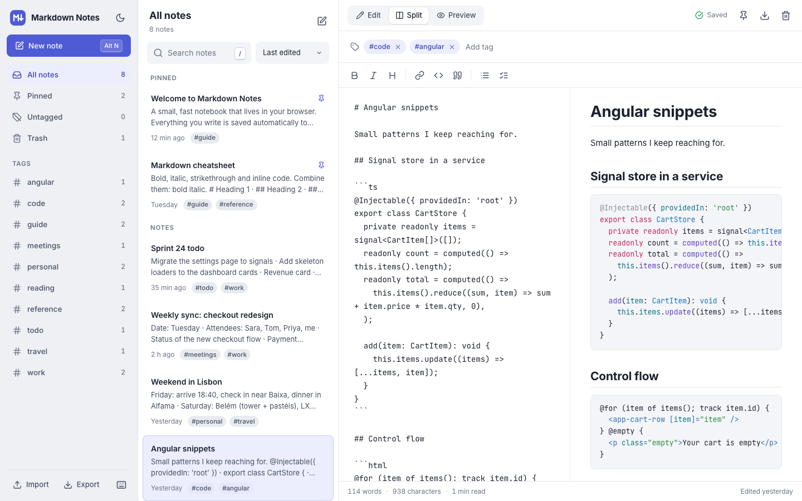
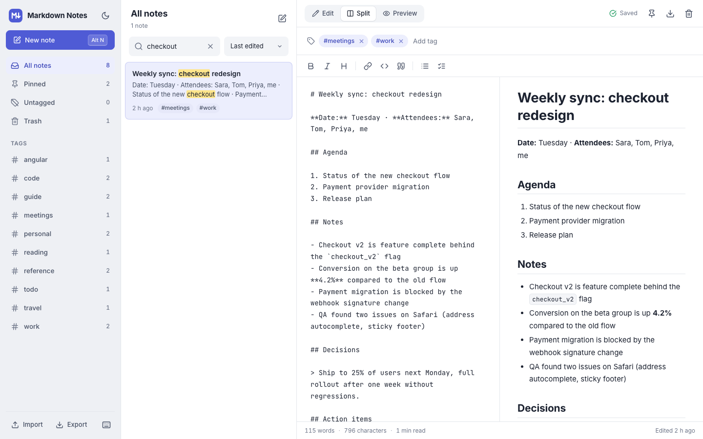
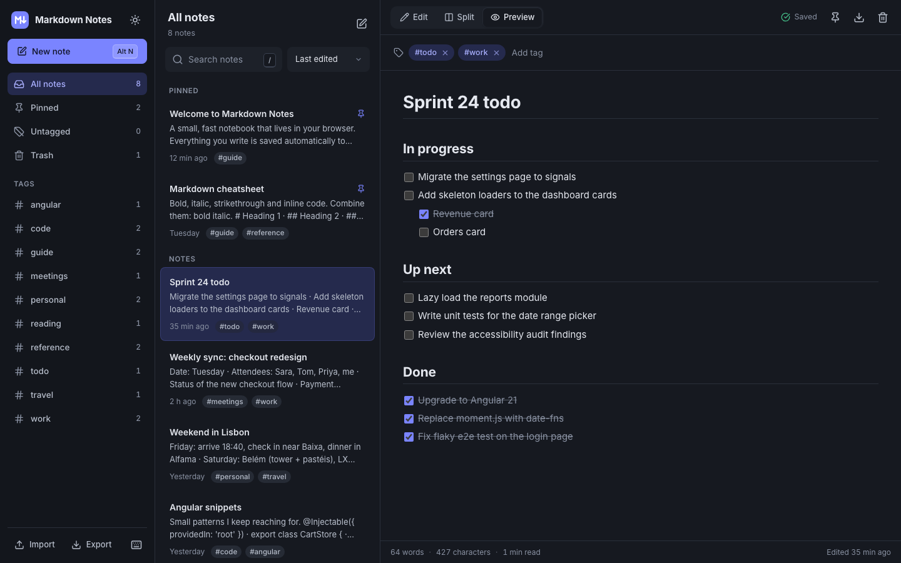
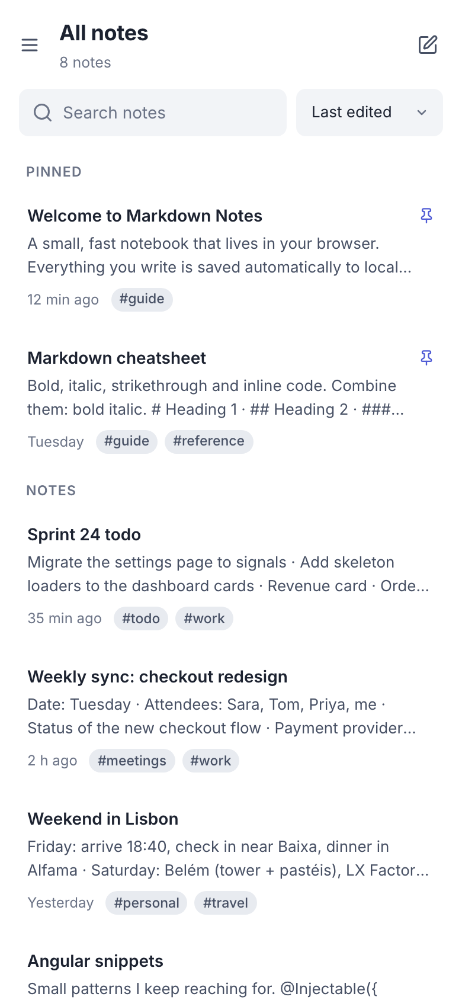
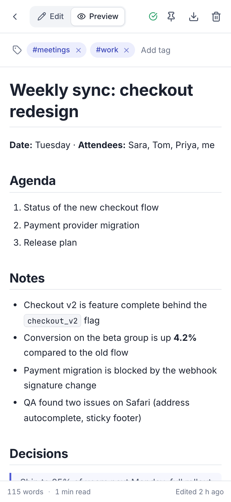

# Markdown Notes

A fast, offline-first markdown notebook built with Angular 21: write with a live preview, organize notes with tags and pins, search everything instantly and keep your data as plain `.md` files.

**[Live Demo](https://hkhodkar.github.io/markdown-notes/)**



| Search with highlighted matches | Dark theme, preview mode |
| --- | --- |
|  |  |

| Phone: notes list | Phone: note preview |
| --- | --- |
|  |  |

## Features

- **Three-pane layout** - sidebar with views and tags, notes list and editor on desktop; the sidebar becomes a drawer on tablets and phones get a list → editor flow with a back button
- **Markdown editor** - toolbar for bold, italic, heading, link, list, task list, code and quote; `Ctrl/⌘ + B / I / K` shortcuts, `Tab` / `Shift + Tab` to indent, lists continue on `Enter`, and the browser's undo keeps working
- **Edit, split and preview modes** - live preview powered by `marked`, sanitized with DOMPurify, with synchronized scrolling in split mode
- **Syntax highlighting** - highlight.js with only the languages you need registered (TypeScript, HTML, SCSS, JSON, Bash, Python, SQL, YAML...) to keep the bundle small
- **Clickable task lists** - ticking a checkbox in the preview updates the markdown source
- **Notes list** - title from the first heading (or first line), excerpt, relative "edited" time and tag chips; sort by last edited, date created or title; pinned notes get their own section on top
- **Search** - debounced search across titles and content with highlighted matches, quoted phrases (`"team meeting"`) and `#tag` terms; the excerpt jumps to the first match
- **Tags** - add tags with an autocomplete input (keyboard friendly), filter by tag in the sidebar with counts, rename (or merge) and delete tags
- **Trash** - deleted notes go to the trash with an undo toast; restore them or delete them for good, or empty the trash
- **Autosave** - changes are saved after a short pause with a "Saved" indicator; word count, character count and reading time in the footer
- **Import and export** - download the current note as `.md`, export all notes as a `.zip` or a single combined `.md`, import `.md` files with the file picker or by dropping them anywhere on the page (tags round-trip through YAML front matter)
- **Local storage with a schema version** - a small storage abstraction behind an injection token, unreadable data is backed up instead of overwritten, and open tabs stay in sync
- **Dark and light theme** - follows the system setting until you pick one, no flash on load
- **Keyboard first** - `Alt + N` new note, `/` search, `?` shows all shortcuts
- **Demo data** - eight useful notes on first run (markdown cheatsheet, meeting notes, a sprint todo list, code snippets, a reading list table and more) with a one-click reset

## Tech Stack

- [Angular 21](https://angular.dev) - standalone components, signals and `computed`, `@if` / `@for` / `@let`, zoneless change detection, OnPush everywhere, `inject()`, lazy-loaded routes with component input binding
- Signals store for notes, filters and preferences, persisted through a `KeyValueStorage` abstraction
- [marked](https://marked.js.org) (GFM), [DOMPurify](https://github.com/cure53/DOMPurify) and [highlight.js](https://highlightjs.org) core
- [fflate](https://github.com/101arrowz/fflate) for `.zip` export, loaded on demand
- Typed reactive forms
- SCSS with CSS custom properties for both themes (no UI library)
- [Vitest](https://vitest.dev/) for unit tests
- GitHub Actions + GitHub Pages for deployment

## Getting Started

Requirements: Node.js 20.19+ or 22.12+ and npm.

```bash
git clone https://github.com/hkhodkar/markdown-notes.git
cd markdown-notes
npm install
npm start
```

Then open http://localhost:4307.

Other useful commands:

```bash
npm test -- --watch=false   # run unit tests
npm run build               # production build in dist/
```

## Project Structure

```
src/
├── app/
│   ├── core/
│   │   ├── data/          # demo notes
│   │   ├── markdown/      # marked + DOMPurify + highlight.js renderer
│   │   ├── models/        # Note, views, sort keys, editor modes
│   │   ├── services/      # preferences, theme, breakpoints, import/export
│   │   ├── storage/       # storage abstraction and versioned notes repository
│   │   ├── store/         # NotesStore (signals)
│   │   └── utils/         # search, toolbar text transforms, tasks, file names, front matter (unit tested)
│   ├── features/
│   │   ├── notes/         # page layout, sidebar, notes list, rename tag and shortcuts dialogs
│   │   └── editor/        # editor with toolbar and preview, tag autocomplete input
│   ├── shared/
│   │   ├── directives/    # click outside
│   │   ├── pipes/         # relative time
│   │   └── ui/            # icons, modal, confirm dialog, toasts
│   ├── app.routes.ts      # lazy-loaded routes
│   └── app.ts             # root component
└── styles/                # theme tokens, base styles, controls, markdown preview
```

## Author

**Hatef Khodkar** - [github.com/hkhodkar](https://github.com/hkhodkar)

## License

[MIT](LICENSE)
